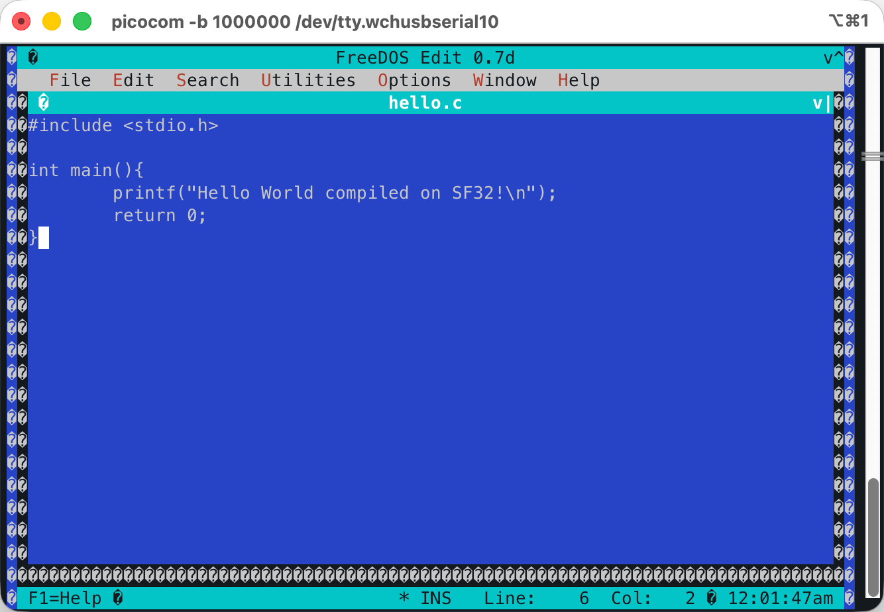
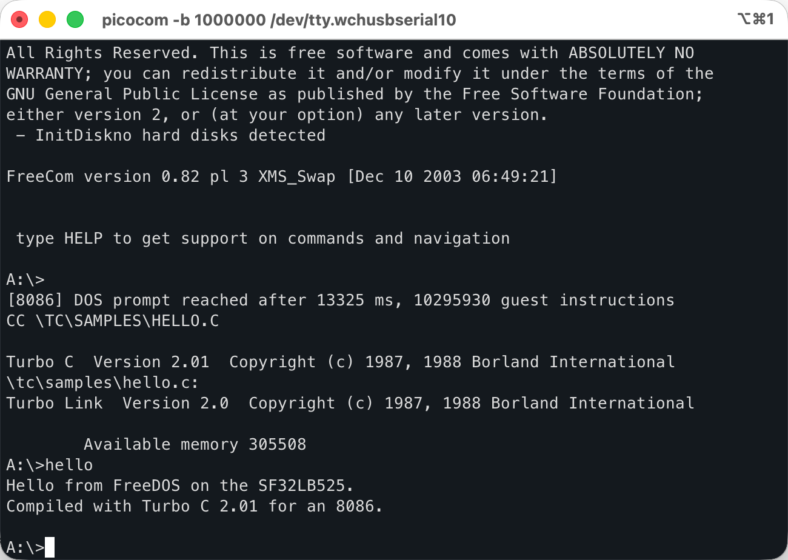

# sf8086

8086tiny ported to the SiFli SF32LB525 (黄山派) board. FreeDOS runs on the board's
Cortex-M33 and is used through UART1. The BIOS, the boot floppy and a C compiler
are held in the firmware; no external storage or file system is involved.

[中文说明](README.zh-CN.md)

## Contents

- FreeDOS on drive A:, a RAM disk rebuilt from flash at every boot.
- Turbo C 2.01 with the small model libraries, invoked as `CC hello.c`.
- The FreeDOS tool set of the boot disk: EDIT, XCOPY, MOVE, DEBUG, FDISK, FORMAT,
  ZIP and others.
- About 144 KB of free space on A:.
- RT-Thread shell, sharing UART1 with the DOS console.

The console is text only. Graphics modes are not displayed.

## Requirements

- SF32LB525 board, board id `sf32lb52-lchspi-ulp`.
- SiFli SDK checkout including the Arm toolchain.
- Serial terminal on UART1 (PA18 RX, PA19 TX).

## Build

```sh
source /path/to/SiFli-SDK/export.sh
cd sdk_probe/project
scons --board=sf32lb52-lchspi-ulp -j8
```

Output is `build_sf32lb52-lchspi-ulp_hcpu/main.bin` with `sftool_param.json`, for
sftool or the CodeKit extension. The image occupies about 1.8 MB of the 8 MB code
region and 193 KB of the 523 KB internal SRAM.

## Shell commands

The serial port comes up as the RT-Thread shell.

| Command | Effect |
|---------|--------|
| `sf8086` | Start DOS. Executed again while paused, it reboots from a clean floppy. |
| `Ctrl-]` | Pause DOS and return UART1 to the shell. |
| `sf8086run` | Continue a paused session. |
| `psram_smoke` | Check guest RAM and the console. |
| `resetinfo` | Report the source of the last reset. |
| `help` | List the remaining commands. |

While DOS runs, UART1 is held by the emulator and the shell does not read it.
`Ctrl-]` is consumed by the firmware and is not passed to the guest.

## DOS environment

| Path | Contents |
|------|----------|
| `A:\CC.BAT` | `CC hello.c` compiles and links to `HELLO.EXE`. |
| `A:\TC` | Compiler, linker, headers, small model libraries. |
| `A:\TC\SAMPLES` | HELLO.C, SIEVE.C, FILEIO.C, KEYTEST.C. |
| `A:\FREEDOS\BIN` | FreeDOS tool set. |

Writes to A: are held in RAM and are lost on reboot. Work done in DOS does not
modify the image in flash.

FreeDOS is what the shipped image contains. MS-DOS 6.22 can be used instead:
`sh tools/floppy/build_msdos.sh` builds the boot image from your own MS-DOS boot
floppy, and the firmware is rebuilt as usual afterwards. See
[tools/floppy/README.md](tools/floppy/README.md).

Alt key combinations: the emulated BIOS uses `Ctrl+A` as an Alt prefix, and the
firmware converts the `ESC`+key sequence produced by terminals. `KEYTEST` prints
the scan code and ASCII value received for each key press.

## Screenshots

Captured from the board's UART console.



*The DOS editor (EDIT).*



*Turbo C 2.01 compiling a program.*

## Performance

Booting to the DOS prompt executes approximately 2.5×10⁸ guest instructions. That
takes about 2 s on a desktop PC; the board's Cortex-M33 runs at 240 MHz. The
firmware prints the measured value when the guest first reaches its prompt:

```text
[8086] DOS prompt reached after <ms> ms, <n> guest instructions
```

## Documentation

- Porting notes, console ownership and design constraints:
  [third_party/8086tiny/PORTING.md](third_party/8086tiny/PORTING.md)
- Floppy contents and rebuild instructions:
  [tools/floppy/README.md](tools/floppy/README.md)
- Repository layout and commit conventions:
  [docs/CONVENTIONS.md](docs/CONVENTIONS.md)

## Credits

- **8086tiny** (MIT, Adrian Cable): the emulator. The core, its BIOS sources and
  the boot floppy are vendored in `third_party/8086tiny/`. Two edits to the
  upstream file, both behind macros: terminal I/O is routed to the port layer, and
  `mem` is a pointer so that guest RAM can be allocated from PSRAM.
- **FreeDOS** (GPL-2.0-or-later): the kernel, FreeCOM and the tool set on the
  floppy, unmodified.
- **Alley Cat**: game distributed with 8086tiny, retained on the floppy.
- **Turbo C 2.01** (Borland, 1989): the C toolchain. Released for free use;
  redistribution is not explicitly granted.
  [tools/floppy/payload/README.md](tools/floppy/payload/README.md) describes how
  to build the image without it.
- **SiFli SDK** with **RT-Thread** (Apache-2.0): RTOS, drivers and board support.
  Not vendored.
- **Arm GNU Toolchain** (GPL-3.0 with the Arm exception): build toolchain. Not
  vendored.

The port itself (`port/`, `sdk_probe/`, `tools/`) is Copyright (C) 2026
equence (equence@qq.com). The two changes to
`third_party/8086tiny/8086tiny.c` carry the same notice beside the upstream
header.

Turbo C 2.01 is included for convenience, not because its terms permit
redistribution: Borland released it for free use, without explicitly granting the
right to pass it on. If you hold the rights to it and object to its presence
here, open an issue in this repository and it will be removed.
